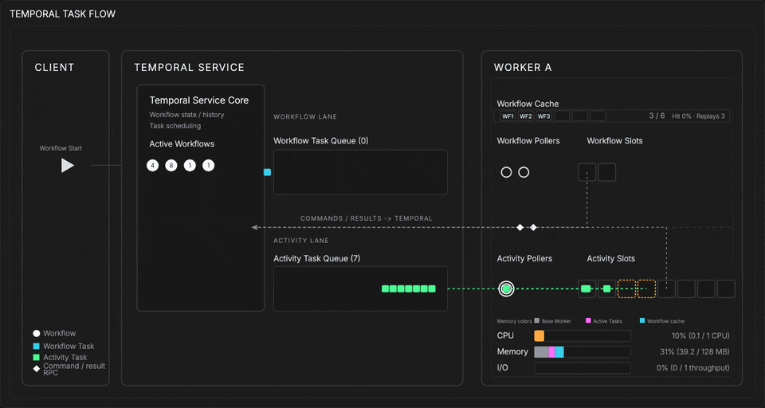
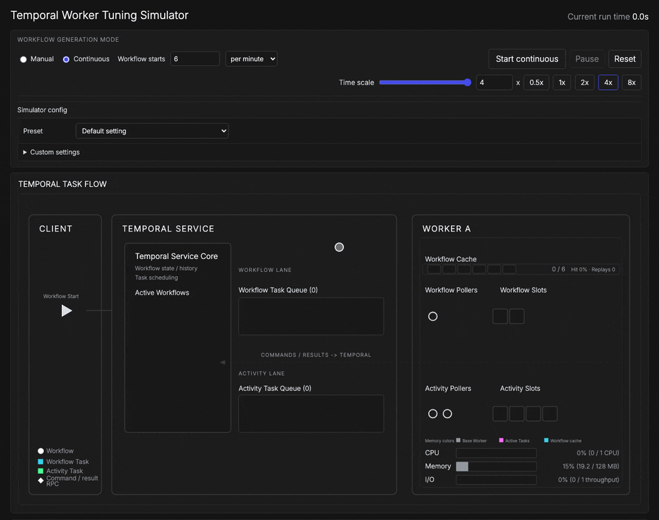
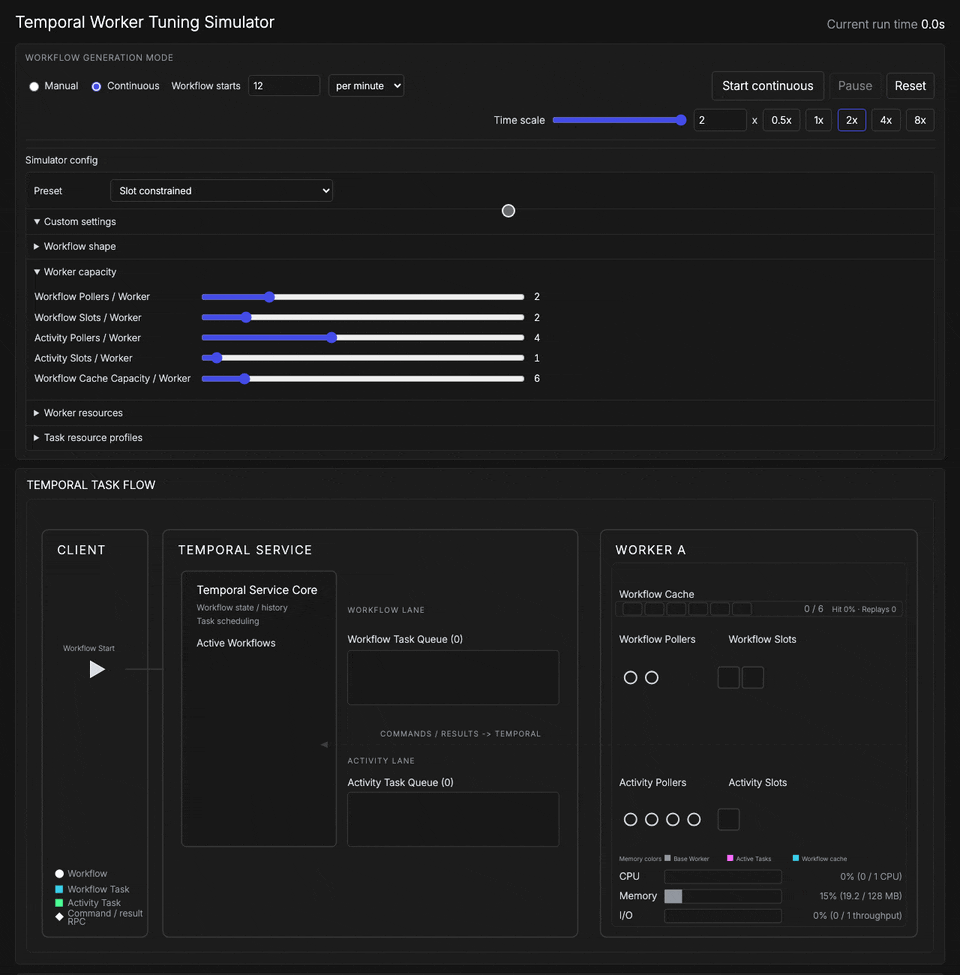
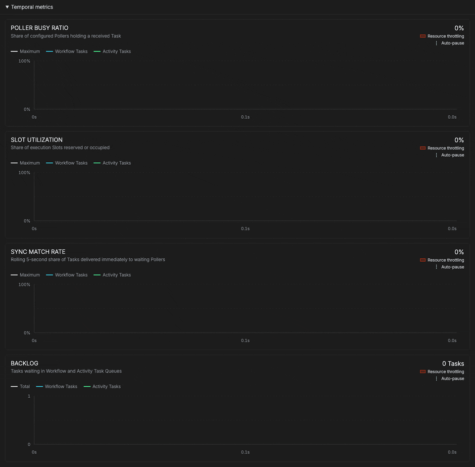

# Temporal Worker Tuning Simulator

A browser-based simulator that shows how Worker Pollers, Slots, Workflow cache, and CPU, memory, and I/O capacity shape Task throughput and Task Queue backlog.



## Quick start

Requires Node.js 20.19 or later.

```sh
npm install
npm run dev
```

Open the URL Vite prints, then press **Start continuous**.

## Run a preset



Each preset loads a workload and Worker configuration that reproduces one bottleneck.
Pick one from the **Preset** menu, then press **Start continuous**.
You can switch presets while a run is in progress.

| Preset | Bottleneck | What to watch |
| --- | --- | --- |
| Default setting | None | Tasks match to waiting Pollers immediately and the queues stay empty. |
| Default setting (manual mode) | None | Starts a fixed number of Workflows and auto-pauses when they finish. |
| Poller constrained | One Activity Poller feeding eight Activity Slots | Slots sit idle while the Activity Task Queue grows. |
| Slot constrained | One Activity Slot | Pollers wait for a free Slot and Activity Tasks queue behind it. |
| CPU constrained | 0.5 CPU shared by CPU-bound Activities | The CPU meter pins at 100%, Tasks slow down, and the backlog grows even though Slots are free. |
| I/O constrained | Half the I/O throughput for I/O-bound Activities | The I/O meter saturates while CPU stays low. |
| Memory constrained | 64 MB of Worker memory with a 3 MB-per-entry Workflow cache | Cache evictions force Workflow replays, lowering the cache hit rate. |

The time scale controls run the simulation from 0.25x to 8x real time.
**Reset** clears the run and keeps the current settings.

## Tune with sliders



Open **Custom settings** to change any value while the simulation runs.
Changes apply immediately, and the **Preset** menu switches to **Custom** once the settings no longer match a preset.

**Workflow shape** sets the number of execution phases and the number of Activities per phase.
Each Workflow Task schedules one phase, and every Activity in that phase must finish before the next Workflow Task runs.

**Worker capacity** maps to these Worker options:

| Slider | Go SDK option | Python SDK option |
| --- | --- | --- |
| Workflow Pollers / Worker | `MaxConcurrentWorkflowTaskPollers` | `max_concurrent_workflow_task_polls` |
| Workflow Slots / Worker | `MaxConcurrentWorkflowTaskExecutionSize` | `max_concurrent_workflow_tasks` |
| Activity Pollers / Worker | `MaxConcurrentActivityTaskPollers` | `max_concurrent_activity_task_polls` |
| Activity Slots / Worker | `MaxConcurrentActivityExecutionSize` | `max_concurrent_activities` |
| Workflow Cache Capacity / Worker | `worker.SetStickyWorkflowCacheSize` | `max_cached_workflows` |

**Worker resources** sets the CPU, memory, and I/O capacity of each Worker, plus the memory each cached Workflow uses.

**Task resource profiles** marks Workflow Tasks and Activity Tasks as CPU-bound or I/O-bound and sets their demand, base duration, duration jitter, and replay latency.
**Lock profile types** keeps both Task types on the same profile.

## Monitor live metrics



Expand **Monitoring** below the Task flow diagram to chart the current run as it happens.
Charts plot simulated time, split Workflow Tasks from Activity Tasks, shade periods of resource throttling, and mark auto-pauses.
Metrics are held in the browser for the current run only, and **Reset** clears them.

| Section | Chart | Closest production metric |
| --- | --- | --- |
| Temporal metrics | Poller busy ratio | Poll success rate: `temporal_cloud_v1_poll_success_count` against `temporal_cloud_v1_poll_timeout_count` |
| | Slot utilization | `temporal_worker_task_slots_used` against `temporal_worker_task_slots_available` |
| | Sync match rate | `temporal_cloud_v1_poll_success_sync_count` divided by `temporal_cloud_v1_poll_success_count` |
| | Backlog | `temporal_cloud_v1_approximate_backlog_count` |
| Worker resources | CPU, memory, and I/O utilization | Host or container metrics, such as `container_cpu_usage_seconds_total` and `container_memory_usage_bytes` |
| Load testing | Task throughput | Rate of `temporal_workflow_task_execution_latency_count` and `temporal_activity_execution_latency_count` |
| | Task completion latency | `temporal_workflow_task_schedule_to_start_latency` and `temporal_activity_schedule_to_start_latency` plus execution latency |
| | Task statistics | Completed counts, throughput, and P25 through P99 latency for the run |

Self-hosted clusters emit the server metrics without the `temporal_cloud_v1_` prefix, for example `poll_success_sync` and `approximate_backlog_count`.

**Diagnostics** at the bottom of the page shows the raw simulation state as JSON.

## How the model works

The simulator runs a deterministic, fixed-step engine in the browser.
Workflows start at the Client, the Temporal Service schedules Workflow Tasks and Activity Tasks onto separate Task Queues, and the Worker's Pollers and Slots pull and execute them against shared CPU, memory, and I/O.
A sticky Workflow cache lets later Workflow Tasks skip replay when the Workflow is still cached.

The design specs describe the behavior in detail:

- [`design/SCOPE_BEHAVIOR_SPEC.md`](design/SCOPE_BEHAVIOR_SPEC.md) covers what the simulator teaches.
- [`design/SIM_ENGINE_SPEC.md`](design/SIM_ENGINE_SPEC.md) covers the simulation mechanics.
- [`design/VISUAL_SPEC.md`](design/VISUAL_SPEC.md) covers the visual and interaction model.

## Development

```sh
npm test
npm run build
```

Enable the sensitive-content pre-commit hook once after cloning:

```sh
git config core.hooksPath .githooks
```

See [`CONTRIBUTING.md`](CONTRIBUTING.md) for details.

### Regenerate the README GIFs

The GIFs in `docs/media/` are recorded by [`scripts/record-readme-media.mjs`](scripts/record-readme-media.mjs), which drives the app in headless Chromium.
Re-record them after UI changes.

```sh
brew install ffmpeg gifski
npx playwright install chromium
npm run readme:media
```

Pass scene names to record a subset, for example `npm run readme:media -- tuning monitoring`.
